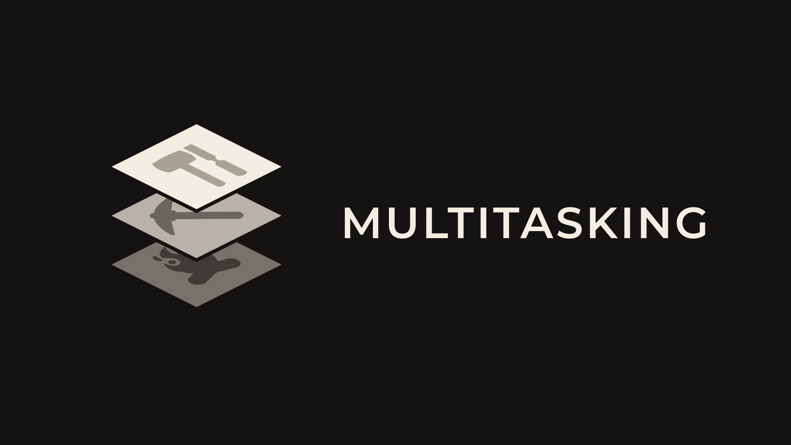

Train combat and multiple skills simultaneously in Melvor Idle 2. A `+N` chip in the footer opens a list of everything running.

## Install

- Download the zip from [Releases](../../releases) and close the game.
- Extract everything in the zip into the game's folder, next to `Melvor2.exe` (Steam: right-click the game, Manage, Browse local files). Replace files if asked.
- Start the game. Updating is the same with the new zip.
- Works with the other mods released by Crash: extract each zip the same way, in any order.

## Uninstall

- Delete `mods/Multitasking/` in the game's folder.
